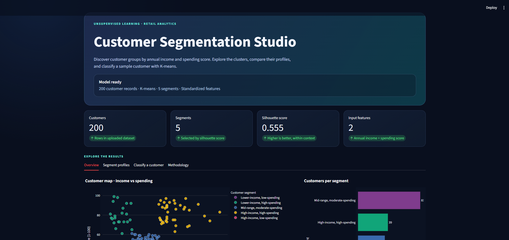
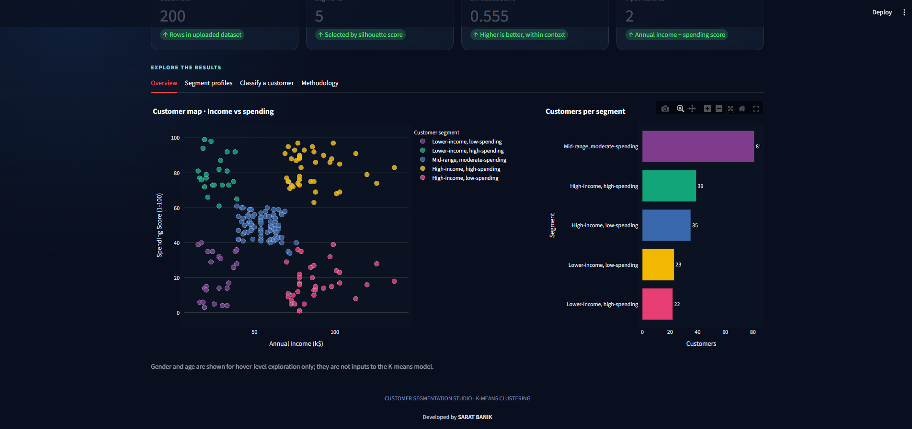
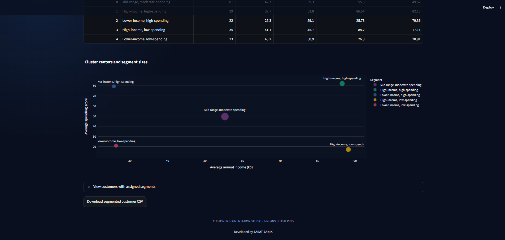
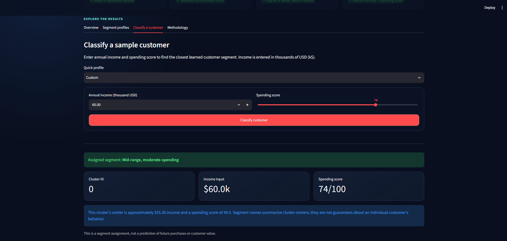
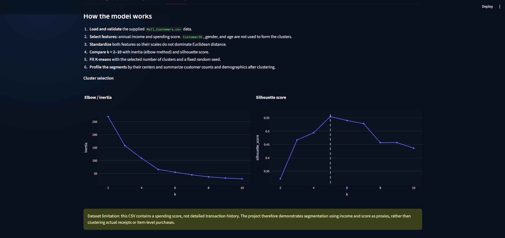
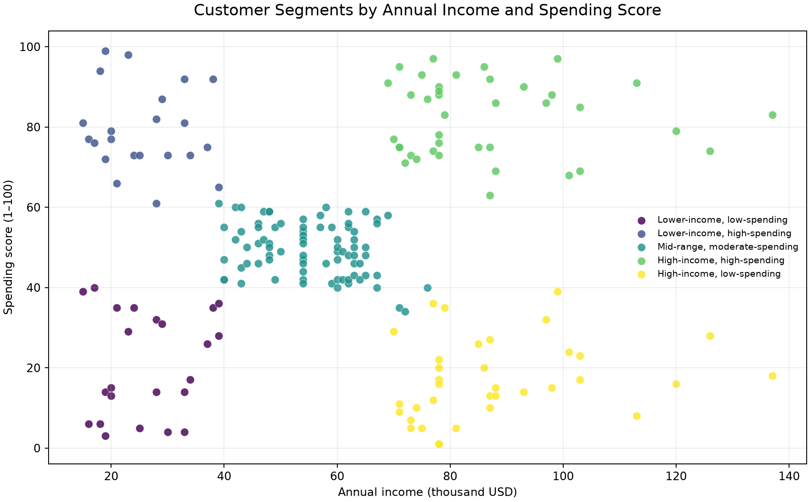
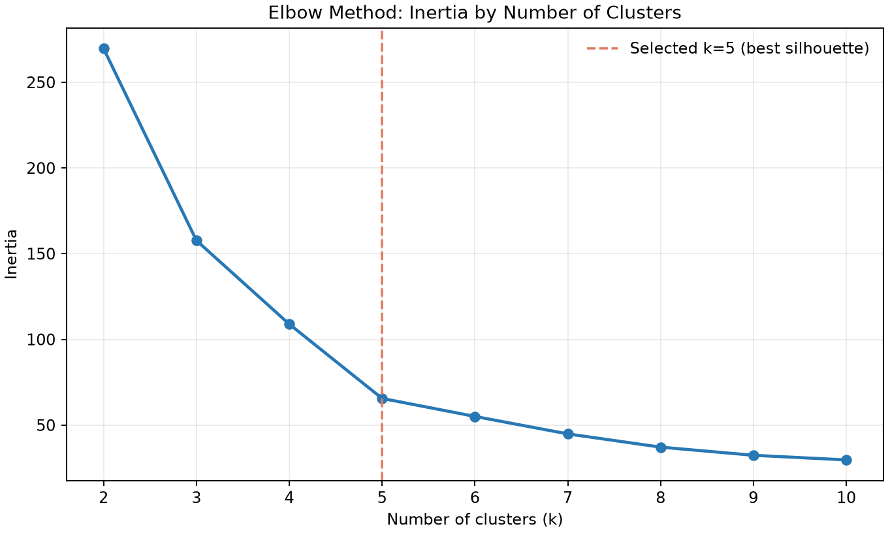
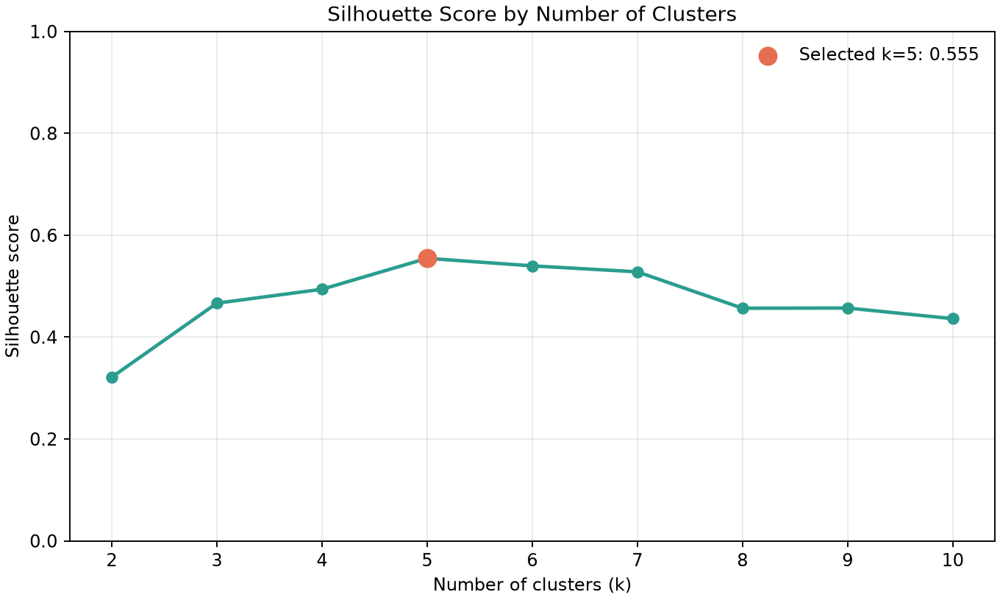
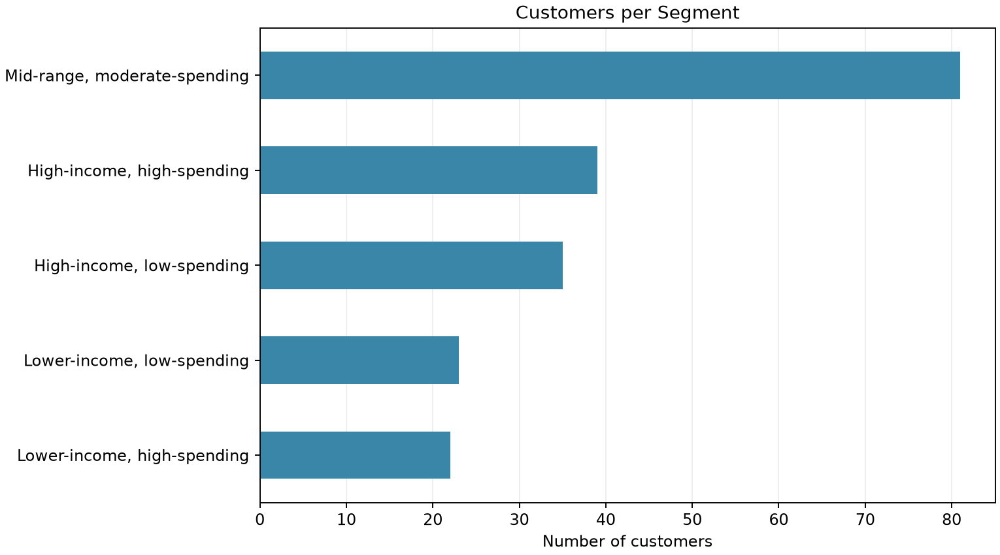

# Customer Segmentation Using K-Means

A Python machine-learning project that groups retail customers into meaningful segments using **annual income** and **spending score**. It includes a reproducible K-means training pipeline, cluster-selection analysis, customer profiles, interactive visualizations, a Streamlit dashboard, and a command-line segment predictor.

> **Dataset scope:** The supplied Mall Customers dataset contains a spending score, not transaction-level purchase history. This project uses annual income and spending score as proxy features. It does not claim to cluster individual purchases or predict future purchasing behavior.

## Model results on the supplied dataset

- **Customers:** 200
- **Missing clustering-feature values:** 0
- **Duplicate customer IDs:** 0
- **Selected cluster count:** 5 (best silhouette score among tested values from 2 to 10)
- **Silhouette score:** 0.5547
- **Inertia:** 65.5684

Segment counts for this run:

| Segment | Customers | Average income (k$) | Average spending score |
|---|---:|---:|---:|
| Mid-range, moderate-spending | 81 | 55.30 | 49.52 |
| High-income, high-spending | 39 | 86.54 | 82.13 |
| High-income, low-spending | 35 | 88.20 | 17.11 |
| Lower-income, low-spending | 23 | 26.30 | 20.91 |
| Lower-income, high-spending | 22 | 25.73 | 79.36 |

These are results from this dataset, selected features, random seed, and k-search range. A silhouette score is not classification accuracy; cluster quality should also be judged from the plots and business context.

## Highlights

- Data validation and exploratory checks.
- Feature standardization with `StandardScaler`.
- Compare `k = 2` through `k = 10` using inertia and silhouette score.
- Select the cluster count with the highest silhouette score in the tested range.
- K-means clustering with a reproducible random seed.
- Interpretable segment labels and cluster-center profiles.
- Interactive Streamlit dashboard with Plotly charts.
- Predict a segment for a sample income / spending score pair.
- Export cluster assignments, profiles, model, metrics, and charts.

## Application screenshots

The Streamlit dashboard brings the clustering results into an interactive interface. The screenshots below follow the main user journey, from the dashboard overview through customer segments, sample classification, and model methodology.

### 1. Dashboard overview



### 2. Customer clusters and segment sizes



### 3. Segment profiles and cluster centers



### 4. Classify a sample customer



### 5. Methodology and cluster selection



## Preview charts

### Customer segments



### Choosing the number of clusters

| Elbow / inertia | Silhouette score |
|---|---|
|  |  |

### Segment sizes



## Dataset

The supplied `data/Mall_Customers.csv` contains 200 customer records and five columns:

| Column | Meaning | Used as K-means input? |
|---|---|---|
| `CustomerID` | Customer identifier | No |
| `Gender` | Recorded gender | No; descriptive profiling only |
| `Age` | Customer age | No; descriptive profiling only |
| `Annual Income (k$)` | Annual income in thousand USD | Yes |
| `Spending Score (1-100)` | Spending score from 1 to 100 | Yes |

Source listed in the task: [Customer Segmentation Tutorial dataset on Kaggle](https://www.kaggle.com/datasets/vjchoudhary7/customer-segmentation-tutorial-in-python).

## Notebook

Open `customer_segmentation_kmeans.ipynb` in VS Code or Jupyter and run its cells from top to bottom for a guided walkthrough of data checks, feature scaling, the elbow and silhouette methods, final clustering, segment profiles, and a sample assignment.

## Tech stack

- Python
- pandas and NumPy
- scikit-learn
- Matplotlib
- Plotly
- Streamlit
- joblib

## Getting started

Download and extract this project, or clone it from the GitHub repository where you upload it. Open the project root (the folder containing `train_model.py`) in VS Code.

### 2. Create a virtual environment (Windows PowerShell)

```powershell
py -m venv .venv
.\.venv\Scripts\Activate.ps1
```

### 3. Install dependencies

```bash
python -m pip install --upgrade pip
pip install -r requirements.txt
```

### 4. Train and evaluate

```bash
python train_model.py
```

The default dataset is `data/Mall_Customers.csv`; the default output folder is `artifacts/`. The model evaluates k=2–10 and selects the candidate with the highest silhouette score in that range.

To provide a different data path or output folder:

```bash
python train_model.py --data "data/Mall_Customers.csv" --output-dir artifacts --k-min 2 --k-max 10
```

### 5. Run the dashboard

```bash
streamlit run app.py
```

Open the local URL displayed by Streamlit, normally `http://localhost:8501`.

### 6. Predict a segment from the terminal

Train the model first, then run:

```bash
python predict_segment.py --income 60 --spending-score 50
```

`--income` is measured in **thousands of USD**. The spending score must be between 1 and 100.

## Generated outputs

| File | Description |
|---|---|
| `artifacts/customer_segmentation_model.joblib` | Saved scaler and K-means model |
| `artifacts/metrics.json` | Selected k, silhouette score, inertia, data checks, and search results |
| `artifacts/clustered_customers.csv` | Original customer rows plus cluster ID and segment name |
| `artifacts/cluster_profiles.csv` | Segment counts and descriptive averages |
| `artifacts/cluster_centers.csv` | Cluster centers in original feature units |
| `artifacts/cluster_selection_scores.csv` | Inertia and silhouette values for each tested k |
| `artifacts/customer_segments.png` | Income-versus-spending cluster scatter plot |
| `artifacts/elbow_method.png` | Inertia by k |
| `artifacts/silhouette_scores.png` | Silhouette score by k |
| `artifacts/segment_sizes.png` | Number of customers per segment |
| `artifacts/feature_distributions.png` | Feature distribution histograms |

## How to interpret the model

K-means assigns each customer to the nearest cluster center in standardized feature space. `StandardScaler` is used because the features should be comparable in scale. Cluster IDs are arbitrary; the app also displays readable segment labels based on center income and spending score.

- **Inertia:** within-cluster squared-distance sum; typically decreases as k grows.
- **Silhouette score:** evaluates cluster cohesion and separation; higher is generally better, but should be interpreted alongside the scatter plot and business context.

The project selects k by maximum silhouette score from the tested values, not by a claim that this is the universally correct number of customer segments.

## Limitations and next steps

This is a small educational dataset. It does not contain detailed basket-level transactions, product categories, purchase dates, or actual customer lifetime value. A real retail project could add RFM features (recency, frequency, monetary value), product-category preferences, and business validation. Cluster labels are descriptive, not verified customer personas.

## Author

Developed by **Sarat Banik**.

[LinkedIn](https://www.linkedin.com/in/saratbanik) · [GitHub](https://github.com/saratbanik)

## License

Add a license only if you are ready to specify the terms under which others may use, modify, and distribute this code. Check the dataset's own terms before redistributing data separately.
